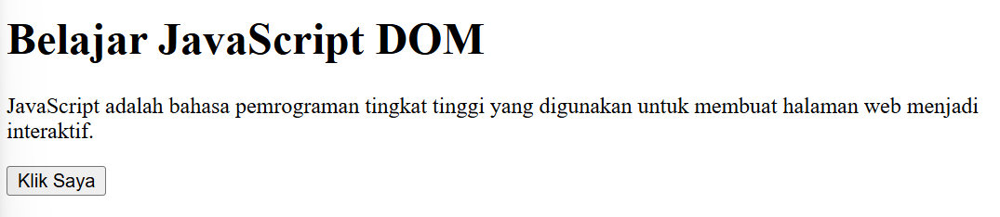
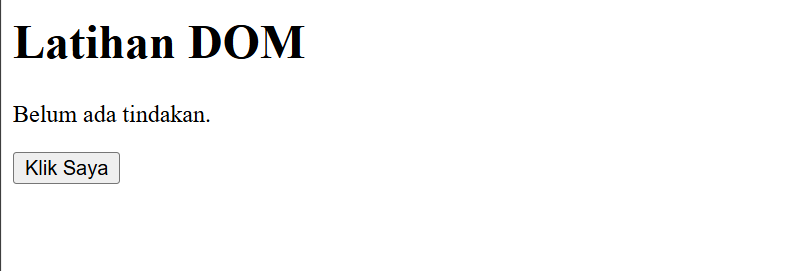
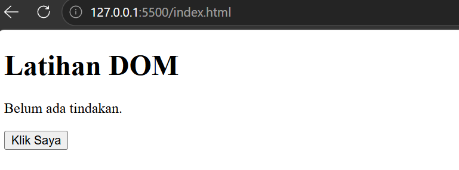
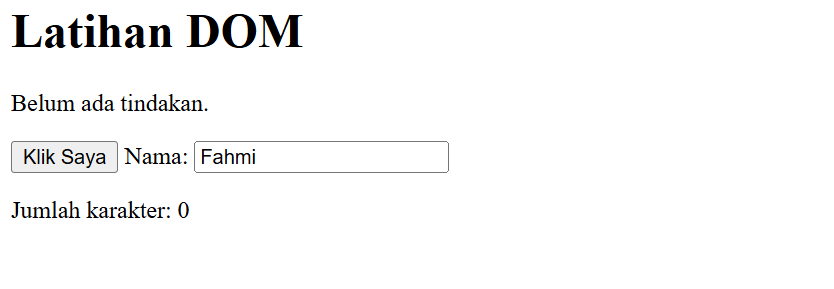
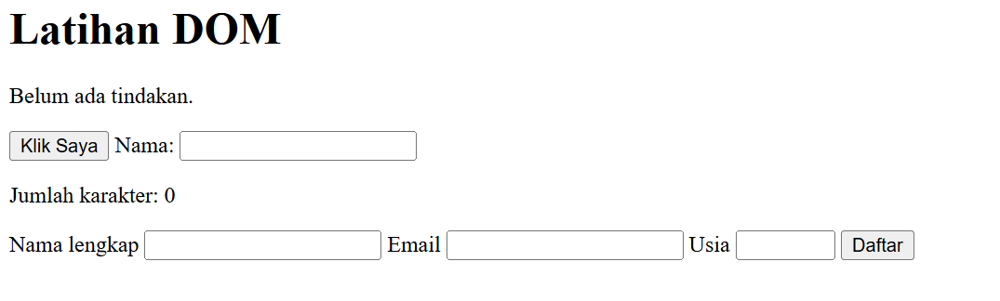
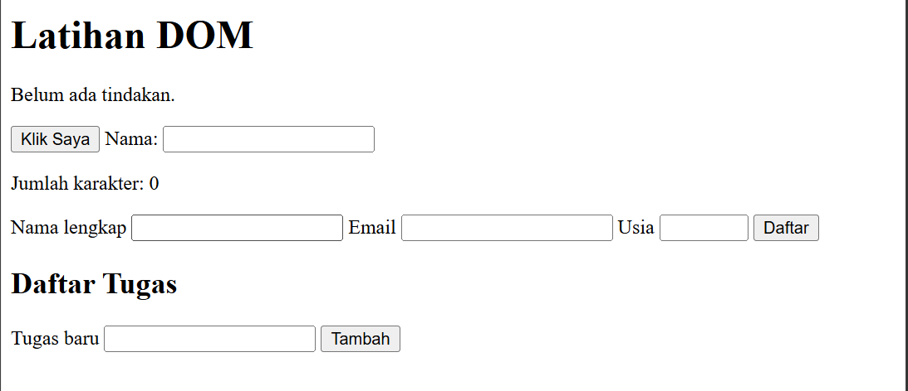
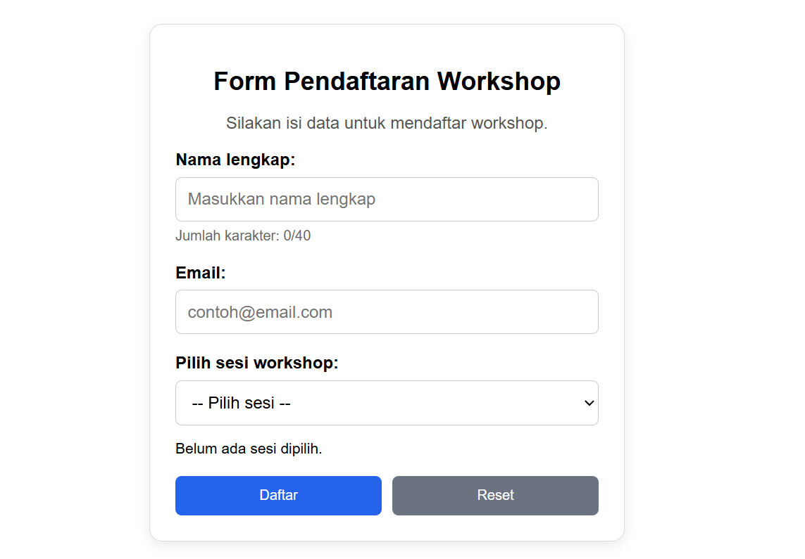
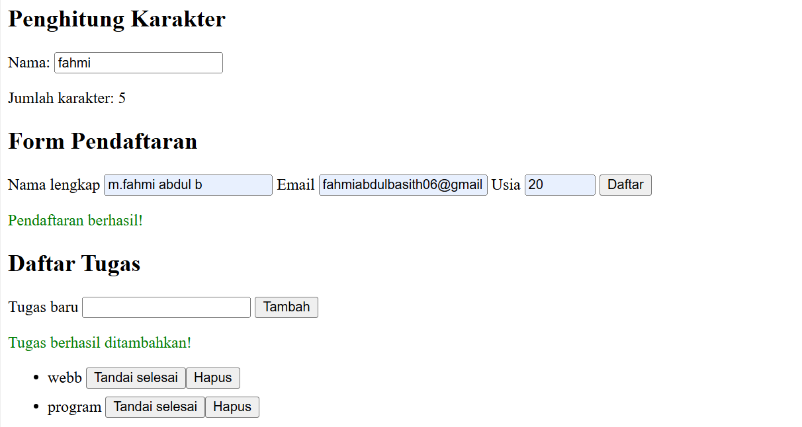

# Praktikum 6: JavaScript DOM dan Event Handling

## Identitas Praktikan

-   **Nama:** M. Fahmi Abdul B.
-   **NIM:** 312510260
-   **Mata Kuliah:** Pemrograman Web
-   **Pertemuan:** 7
-   **Topik:** JavaScript DOM dan Event Handling

## A. Tujuan Praktikum

Berdasarkan modul Praktikum 6, tujuan kegiatan ini adalah: 1. Memahami
DOM sebagai representasi dokumen HTML yang dapat diakses melalui
JavaScript. 2. Menggunakan `id`, `class`, dan selector CSS untuk memilih
elemen HTML. 3. Mengubah teks, atribut, kelas CSS, dan gaya elemen
melalui JavaScript. 4. Menangani event pengguna menggunakan
`addEventListener()`. 5. Membuat validasi form dan menampilkan pesan
sesuai kondisi input. 6. Mengembangkan halaman interaktif dengan minimal
tiga fungsi yang berjalan benar.

## B. Struktur File

Simpan file berikut dalam satu folder proyek, misalnya
`lab6_dom_event/`.

``` text
lab6_dom_event/
├── index.html
├── style.css
├── script.js
└── README.md
```

-   `index.html`: struktur halaman dan elemen yang berinteraksi dengan
    pengguna.
-   `style.css`: tampilan halaman dan kelas CSS, termasuk `.highlight`,
    `.teks-besar`, `.selesai`, dan `.sembunyi`.
-   `script.js`: kode JavaScript untuk memilih elemen DOM, menangani
    event, memvalidasi form, dan mengelola daftar tugas.
-   `README.md`: dokumentasi tujuan, langkah kerja, cara menjalankan,
    dan screenshot hasil.

**Catatan screenshot:** Simpan screenshot hasil di folder proyek yang
sama dengan nama file yang disebutkan pada bagian H di bawah. Dengan
begitu, tidak perlu membuat folder screenshot tambahan.

## C. Persiapan Praktikum

### Langkah 1 --- Membuat folder dan file di Visual Studio Code

1.  Buat folder bernama `lab6_dom_event`.
2.  Buka VS Code, pilih **File → Open Folder...**, lalu pilih folder
    tersebut.
3.  Buat tiga file: `index.html`, `style.css`, dan `script.js`.
4.  Buat file `README.md` untuk dokumentasi.

### Langkah 2 --- Menghubungkan CSS dan JavaScript

Pada bagian `<head>` di `index.html`, gunakan kode berikut:

``` html
<link rel="stylesheet" href="style.css">
<script src="script.js" defer></script>
```

Atribut `defer` membuat browser memproses HTML terlebih dahulu sebelum
menjalankan JavaScript eksternal. Hal ini membantu memastikan elemen
yang dicari oleh JavaScript sudah tersedia.

## D. Cara Menjalankan Program

1.  Simpan seluruh file dengan menekan **Ctrl + S** di VS Code.
2.  Buka `index.html` di browser. Bisa melalui klik kanan `index.html`
    lalu **Open with Live Server** jika ekstensi Live Server tersedia,
    atau buka file HTML tersebut langsung di browser.
3.  Uji setiap tombol, input, dropdown, dan form.
4.  Untuk memeriksa error, buka Developer Tools dengan **F12**, lalu
    pilih tab **Console**.
5.  Jika kode diubah, simpan file dan muat ulang halaman. Gunakan
    **Ctrl + F5** untuk melakukan hard refresh.

## E. Langkah Kerja Praktikum

> Potongan kode di bawah menunjukkan bagian penting untuk setiap
> langkah. Letakkan kode HTML di `index.html`, CSS di `style.css`, dan
> JavaScript di `script.js` sesuai keterangan.

### Langkah 1 --- Latihan 1: Memilih elemen dan mengubah teks DOM

**Tujuan:** Memilih elemen berdasarkan `id`, kemudian memperbarui teks
menggunakan `textContent`.

**Kode HTML (`index.html`):**

``` html
<section>
    <h1 id="judul">Latihan DOM</h1>
    <p id="pesan">Belum ada tindakan.</p>
    <button id="tombolAksi" type="button">Klik Saya</button>
</section>
```

**Kode JavaScript (`script.js`):**

``` javascript
const judul = document.getElementById("judul");
const pesan = document.getElementById("pesan");
const tombolAksi = document.getElementById("tombolAksi");

tombolAksi.addEventListener("click", function () {
    judul.textContent = "Halo, Saya Sedang Belajar DOM!";
    pesan.textContent = "Berhasil! Teks diubah menggunakan JavaScript.";
});
```

**Cara menguji:** 1. Jalankan `index.html`. 2. Klik tombol **Klik
Saya**. 3. Pastikan judul dan paragraf berubah.

### Langkah 2 --- Latihan 2: Menangani event `click`

**Tujuan:** Menggunakan `addEventListener()` untuk menjalankan fungsi
ketika tombol diklik. Modul juga memberi contoh menampilkan waktu saat
tombol ditekan.

**Contoh JavaScript (`script.js`):**

``` javascript
const tombolAksi = document.getElementById("tombolAksi");
const pesan = document.getElementById("pesan");

tombolAksi.addEventListener("click", function () {
    pesan.textContent =
        "Tombol diklik pada " + new Date().toLocaleTimeString();
});
```

Jika langkah ini dipakai sebagai pengganti kode pada Langkah 1, hasil
klik akan menampilkan waktu klik pada paragraf. Pastikan deklarasi
variabel tidak ditulis dua kali dalam lingkup yang sama di `script.js`;
gabungkan fungsi yang diperlukan ke dalam satu event listener bila kedua
perilaku ingin dipakai bersamaan.

**Cara menguji:** Klik tombol beberapa kali dan amati apakah pesan/waktu
diperbarui.

### Langkah 3 --- Latihan 3: Mengubah class dan gaya CSS

**Tujuan:** Mengubah tampilan elemen menggunakan `classList.toggle()`.

**Kode HTML (`index.html`):**

``` html
<section>
    <h2>Latihan Class dan Gaya</h2>
    <p id="teksLatihan">Teks ini dapat diubah tampilannya.</p>
    <button id="tombolHighlight" type="button">Highlight</button>
    <button id="tombolUkuran" type="button">Ubah Ukuran</button>
</section>
```

**Kode CSS (`style.css`):**

``` css
.highlight {
    color: #173f75;
    background-color: #e6f1ff;
    border-left: 4px solid #3478c8;
    padding: 12px;
}

.teks-besar {
    font-size: 1.4rem;
}
```

**Kode JavaScript (`script.js`):**

``` javascript
const tombolHighlight = document.getElementById("tombolHighlight");
const tombolUkuran = document.getElementById("tombolUkuran");
const teksLatihan = document.getElementById("teksLatihan");

tombolHighlight.addEventListener("click", function () {
    teksLatihan.classList.toggle("highlight");
});

tombolUkuran.addEventListener("click", function () {
    teksLatihan.classList.toggle("teks-besar");
});
```

**Cara menguji:** Klik tombol **Highlight** dan **Ubah Ukuran**.
Perhatikan perubahan warna, latar, garis tepi, dan ukuran teks.

### Langkah 4 --- Latihan 4: Event `input` dan penghitung karakter

**Tujuan:** Memperbarui jumlah karakter secara langsung ketika pengguna
mengetik, menghapus, atau menempelkan teks.

**Kode HTML (`index.html`):**

``` html
<section>
    <h2>Penghitung Karakter</h2>
    <label for="namaInput">Nama:</label>
    <input type="text" id="namaInput" maxlength="40">
    <p>Jumlah karakter: <span id="jumlahKarakter">0</span></p>
</section>
```

**Kode JavaScript (`script.js`):**

``` javascript
const namaInput = document.getElementById("namaInput");
const jumlahKarakter = document.getElementById("jumlahKarakter");

namaInput.addEventListener("input", function () {
    jumlahKarakter.textContent = namaInput.value.length;
});
```

**Cara menguji:** Ketik beberapa karakter, lalu hapus sebagian. Angka
penghitung harus berubah sesuai panjang teks.

### Langkah 5 --- Latihan 5: Validasi form pendaftaran

**Tujuan:** Memeriksa nama, format email, dan usia, lalu menampilkan
pesan yang sesuai.

**Kode HTML (`index.html`):**

``` html
<form id="formPendaftaran" novalidate>
    <label for="nama">Nama lengkap</label>
    <input id="nama" name="nama" type="text">

    <label for="email">Email</label>
    <input id="email" name="email" type="email">

    <label for="usia">Usia</label>
    <input id="usia" name="usia" type="number" min="17" max="100">

    <button type="submit">Daftar</button>
</form>
<p id="pesanForm" aria-live="polite"></p>
```

**Kode JavaScript (`script.js`):**

``` javascript
const formPendaftaran = document.getElementById("formPendaftaran");
const pesanForm = document.getElementById("pesanForm");

formPendaftaran.addEventListener("submit", function (event) {
    event.preventDefault();

    const nama = document.getElementById("nama").value.trim();
    const email = document.getElementById("email").value.trim();
    const usiaInput = document.getElementById("usia").value;
    const usia = Number(usiaInput);
    const polaEmail = /^[^\s@]+@[^\s@]+\.[^\s@]+$/;

    if (nama === "") {
        pesanForm.textContent = "Nama wajib diisi.";
    } else if (!polaEmail.test(email)) {
        pesanForm.textContent = "Masukkan email yang valid.";
    } else if (
        usiaInput === "" ||
        !Number.isInteger(usia) ||
        usia < 17 ||
        usia > 100
    ) {
        pesanForm.textContent =
            "Usia harus berupa bilangan bulat 17–100.";
    } else {
        pesanForm.textContent = "Validasi berhasil. Form siap diproses.";
        formPendaftaran.reset();
    }
});
```

**Cara menguji minimal lima kondisi:** 1. Semua kolom kosong. 2. Nama
kosong. 3. Email tidak valid. 4. Usia di bawah 17 tahun. 5. Semua input
valid.

Pastikan pesan yang muncul sesuai kondisi yang diuji.

### Langkah 6 --- Latihan 6: Daftar tugas sederhana (To-do List)

**Tujuan:** Menambahkan tugas baru dan menandai tugas sebagai selesai.

**Kode HTML (`index.html`):**

``` html
<section>
    <h2>Daftar Tugas</h2>
    <label for="inputTugas">Tugas baru</label>
    <input id="inputTugas" type="text">
    <button id="tambahTugas" type="button">Tambah</button>
    <p id="pesanTugas" aria-live="polite"></p>
    <ul id="daftarTugas"></ul>
</section>
```

**Kode JavaScript (`script.js`):**

``` javascript
const inputTugas = document.getElementById("inputTugas");
const tambahTugas = document.getElementById("tambahTugas");
const daftarTugas = document.getElementById("daftarTugas");
const pesanTugas = document.getElementById("pesanTugas");

tambahTugas.addEventListener("click", function () {
    const teks = inputTugas.value.trim();

    if (teks === "") {
        pesanTugas.textContent = "Tulis tugas terlebih dahulu.";
        return;
    }

    const item = document.createElement("li");
    const label = document.createElement("span");
    const selesai = document.createElement("button");

    label.textContent = teks + " ";
    selesai.type = "button";
    selesai.textContent = "Tandai selesai";

    selesai.addEventListener("click", function () {
        item.classList.toggle("selesai");
        selesai.textContent = item.classList.contains("selesai")
            ? "Batalkan selesai"
            : "Tandai selesai";
    });

    item.append(label, selesai);
    daftarTugas.appendChild(item);

    inputTugas.value = "";
    pesanTugas.textContent = "Tugas ditambahkan.";
    inputTugas.focus();
});
```

**Kode CSS (`style.css`):**

``` css
.selesai span {
    text-decoration: line-through;
    color: #687386;
}

li {
    margin-bottom: 8px;
}
```

**Cara menguji:** Tambahkan tugas, klik **Tandai selesai**, lalu
pastikan teks tugas dicoret. Bagian G nomor 1 akan menambahkan tombol
**Hapus** untuk setiap item.

### Langkah 7 --- Mini Project: Form Pendaftaran Workshop

**Tujuan:** Membuat halaman pendaftaran workshop dengan beberapa fungsi
interaktif: - Validasi nama minimal tiga karakter. - Validasi format
email. - Validasi pilihan sesi workshop. - Penghitung karakter nama
secara langsung. - Ringkasan sesi yang dipilih melalui event `change`. -
Pesan sukses atau kesalahan. - Tombol reset untuk mengosongkan form.

**Kode HTML (`index.html`):**

``` html
<section class="workshop">
    <h1>Form Pendaftaran Workshop</h1>
    <p>Silakan isi data untuk mendaftar workshop.</p>

    <form id="formWorkshop" novalidate>
        <label for="namaWorkshop">Nama lengkap:</label>
        <input type="text" id="namaWorkshop" maxlength="40"
               placeholder="Masukkan nama lengkap">
        <small>Jumlah karakter: <span id="hitungKarakter">0</span>/40</small>

        <label for="emailWorkshop">Email:</label>
        <input type="text" id="emailWorkshop"
               placeholder="contoh@email.com">

        <label for="sesiWorkshop">Pilih sesi workshop:</label>
        <select id="sesiWorkshop">
            <option value="">-- Pilih sesi --</option>
            <option value="HTML dan CSS">HTML dan CSS</option>
            <option value="JavaScript">JavaScript</option>
            <option value="UI/UX Design">UI/UX Design</option>
        </select>

        <p id="ringkasanSesi">Belum ada sesi dipilih.</p>
        <p id="pesanWorkshop" aria-live="polite"></p>

        <button type="submit">Daftar</button>
        <button type="reset">Reset</button>
    </form>
</section>
```

**Contoh JavaScript untuk event `input` dan `change` (`script.js`):**

``` javascript
const namaWorkshop = document.getElementById("namaWorkshop");
const hitungKarakter = document.getElementById("hitungKarakter");
const sesiWorkshop = document.getElementById("sesiWorkshop");
const ringkasanSesi = document.getElementById("ringkasanSesi");

namaWorkshop.addEventListener("input", function () {
    hitungKarakter.textContent = namaWorkshop.value.length;
});

sesiWorkshop.addEventListener("change", function () {
    ringkasanSesi.textContent =
        sesiWorkshop.value || "Belum ada sesi dipilih.";
});
```

Kode validasi submit dan reset untuk Mini Project harus tetap berada di
`script.js`. Pada file proyek ini, bagian tersebut menggunakan elemen
`formWorkshop`, `emailWorkshop`, dan `pesanWorkshop`.

**Kode CSS (`style.css`):** Gunakan aturan `.workshop`, `.form-group`,
`.tombol-group`, dan aturan responsif yang sudah dibuat pada file CSS
proyek.

**Cara menguji:** 1. Isi nama dengan kurang dari tiga karakter dan klik
**Daftar**. 2. Isi email dengan format yang tidak valid. 3. Jangan pilih
sesi, lalu klik **Daftar**. 4. Isi data yang valid dan pilih sesi. 5.
Ubah pilihan sesi dan periksa ringkasan sesi. 6. Klik **Reset** dan
periksa apakah form kembali kosong.

### Langkah 8 --- G. Eksperimen Mandiri

#### G.1 Menambahkan tombol hapus pada To-do List

Buat tombol untuk setiap item tugas dan hapus item tersebut ketika
tombol diklik.

**JavaScript (`script.js`), di dalam event tombol Tambah:**

``` javascript
const hapus = document.createElement("button");
hapus.type = "button";
hapus.textContent = "Hapus";

hapus.addEventListener("click", function () {
    item.remove();
});

item.appendChild(hapus);
```

Letakkan kode setelah elemen `item` dibuat dan sebelum `item` dimasukkan
ke `daftarTugas`.

#### G.2 Validasi nama minimal tiga karakter

**JavaScript (`script.js`), pada validasi Mini Project:**

``` javascript
if (nama.length < 3) {
    pesanWorkshop.textContent =
        "Nama harus terdiri dari minimal 3 karakter.";
    pesanWorkshop.style.color = "red";
    return;
}
```

#### G.3 Event `change` pada dropdown sesi

**JavaScript (`script.js`):**

``` javascript
sesiWorkshop.addEventListener("change", function () {
    ringkasanSesi.textContent =
        sesiWorkshop.value || "Belum ada sesi dipilih.";
});
```

#### G.4 Menyembunyikan dan menampilkan paragraf menggunakan class CSS

**HTML (`index.html`):**

``` html
<p id="paragrafToggle">
    Ini adalah paragraf yang bisa disembunyikan dan ditampilkan kembali.
</p>
<button type="button" id="tombolToggle">Sembunyikan/Tampilkan</button>
```

**CSS (`style.css`):**

``` css
.sembunyi {
    display: none;
}
```

**JavaScript (`script.js`):**

``` javascript
const tombolToggle = document.getElementById("tombolToggle");
const paragrafToggle = document.getElementById("paragrafToggle");

tombolToggle.addEventListener("click", function () {
    paragrafToggle.classList.toggle("sembunyi");

    tombolToggle.textContent =
        paragrafToggle.classList.contains("sembunyi")
            ? "Tampilkan Paragraf"
            : "Sembunyikan Paragraf";
});
```

#### G.5 Menguji script tanpa `defer`

Pada `index.html`, ubah sementara:

``` html
<script src="script.js" defer></script>
```

menjadi:

``` html
<script src="script.js"></script>
```

Letakkan script tersebut di dalam `<head>`, lalu muat ulang halaman.
Karena JavaScript dapat berjalan sebelum elemen HTML selesai dibaca,
pemanggilan `getElementById()` bisa menghasilkan `null` dan pemanggilan
`addEventListener()` dapat menimbulkan error. Setelah pengamatan
selesai, kembalikan `defer` agar script dijalankan setelah HTML selesai
diparsing.

## F. Pengujian dan Hasil

Gunakan daftar berikut saat menguji halaman: - \[ \] Tombol DOM mengubah
teks. - \[ \] Event click berjalan. - \[ \] Class CSS dapat ditambah dan
dihapus. - \[ \] Penghitung karakter mengikuti input. - \[ \] Validasi
form menampilkan pesan yang sesuai. - \[ \] To-do List dapat menambah
dan menandai tugas selesai. - \[ \] Tombol Hapus menghapus item yang
dipilih. - \[ \] Mini Project memvalidasi nama, email, dan sesi. - \[ \]
Dropdown menampilkan sesi yang dipilih. - \[ \] Paragraf dapat
disembunyikan dan ditampilkan menggunakan class CSS. - \[ \] Percobaan
script tanpa `defer` dilakukan dan hasilnya dicatat di Console.

## G. Struktur Screenshot

Ambil screenshot dari hasil yang benar-benar tampil di browser. Simpan
file screenshot di folder yang sama dengan `README.md`, lalu gunakan
nama berikut. Ganti nama file jika screenshot kamu menggunakan nama
lain.

### 1. Latihan mengubah teks dengan DOM



### 2. Latihan class dan gaya CSS



### 3. Mengubah kelas dan gaya CSS



### 4. Event input dan penghitung karakter



### 5. Validasi form --- pendaftaran



### 6. To-do List



### 7. Mini Project Workshop



### 8. Eksperimen tampil/sembunyi dan Console



**Penting:** Gambar di atas merupakan tempat untuk menyisipkan
screenshot. Ambil screenshot hasil dari browser kamu sendiri dan simpan
dengan nama file yang sesuai agar gambar tampil di GitHub.

## H. Pertanyaan Evaluasi

1.  **Apa yang dimaksud dengan DOM dan apa manfaatnya?**\
    DOM adalah representasi dokumen HTML dalam bentuk objek yang dapat
    diakses dan dimanipulasi oleh JavaScript. DOM memungkinkan program
    memilih elemen, mengubah konten, mengubah class CSS, dan merespons
    tindakan pengguna.

2.  **Apa perbedaan `getElementById()`, `querySelector()`, dan
    `querySelectorAll()`?**\
    `getElementById()` memilih elemen berdasarkan ID. `querySelector()`
    memilih elemen pertama yang cocok dengan selector CSS.
    `querySelectorAll()` memilih semua elemen yang cocok dengan selector
    CSS.

3.  **Apa fungsi `addEventListener()` dan sebutkan tiga contoh event?**\
    `addEventListener()` menghubungkan event dengan fungsi yang
    dijalankan ketika event terjadi. Contohnya `click`, `input`, dan
    `change`.

4.  **Mengapa `event.preventDefault()` digunakan pada event submit
    form?**\
    Untuk mencegah perilaku default pengiriman form, sehingga validasi
    dapat dilakukan dan pesan dapat ditampilkan tanpa halaman langsung
    dimuat ulang.

5.  **Apa perbedaan `textContent` dan `innerHTML` dari sisi penggunaan
    dan keamanan?**\
    `textContent` menampilkan teks biasa. `innerHTML` membaca atau
    mengubah markup HTML. Untuk teks yang berasal dari pengguna,
    `textContent` lebih aman karena tidak menafsirkan input sebagai
    HTML.

6.  **Bagaimana `classList.toggle()` membantu mengubah tampilan
    elemen?**\
    `classList.toggle()` menambahkan class jika belum ada dan
    menghapusnya jika sudah ada, sehingga tampilan dapat diaktifkan atau
    dinonaktifkan.

7.  **Sebutkan minimal tiga skenario pengujian validasi form.**\
    Semua input kosong, format email tidak valid, usia di luar rentang
    yang ditentukan, dan semua input valid.

## I. Kesimpulan

Praktikum ini menerapkan pemilihan dan manipulasi elemen DOM, event
handling, perubahan class CSS, penghitung karakter, validasi form, serta
interaksi To-do List dan pendaftaran workshop. Pengujian dilakukan
melalui browser dan Developer Tools/Console untuk memastikan fitur
bekerja sesuai kondisi input.
